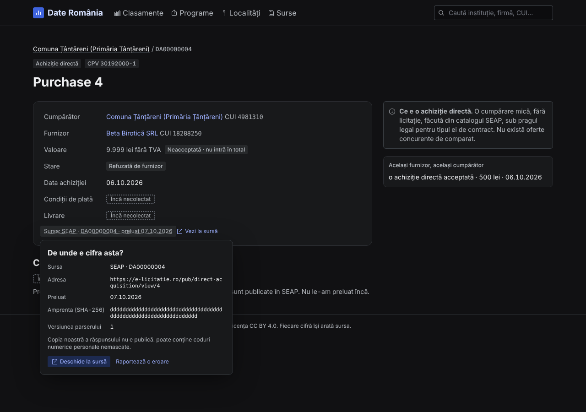

# Reading the figures

The site follows a few fixed rules so that a number always means the same thing. They
are also written, in Romanian, on the sources page under "Metodologie".

## Every figure says where it comes from

Under each figure is a source line:

> Sursa: SEAP · achiziții directe · preluat 10.10.2026

It names the publisher, what kind of record it is, and the day Date România read it.
When two sources stand side by side, each line says what it is the source of ("Sursa
contractelor", "Sursa plăților").

- **For one record** (a purchase, a notice, a contract), the line opens
  **"De unde e cifra asta?"**: the source, its address, the day it was read, a digital
  fingerprint of the copy Date România keeps (a code that changes if a single character
  of the copy changes, so nobody can quietly alter it), a button to open the record at
  the source ("Deschide la sursă"), and "Raportează o eroare". The kept copy itself is
  not public, because it can hold personal ID numbers.

  

  _Made-up test data._

- **For a total**, there is no single file. Its line says how many stored answers it is
  added up from ("adunat din 40 de răspunsuri") and links to the sources page.

## Two kinds of missing, never mixed

| Label                 | Outline | Meaning                                                                                                 |
| --------------------- | ------- | ------------------------------------------------------------------------------------------------------- |
| **"Nepublicat"**      | dashed  | The source does not publish this value. It is not hidden by anyone on purpose; it is simply not public. |
| **"Încă necolectat"** | dotted  | The source publishes it, but Date România has not collected it yet.                                     |

A missing value is never shown as a zero, a dash or "necunoscut" (unknown).

## How sure is a link?

When the site ties two records together, it says how sure the link is:

| Level                      | Evidence                                                                                                                                   |
| -------------------------- | ------------------------------------------------------------------------------------------------------------------------------------------ |
| **Sure** ("sigură")        | The same tax ID (CUI) on both records, or both named in one published record                                                               |
| **Probable** ("probabilă") | Strong evidence put together by Date România, for example the builder's CUI plus a buyer with the town hall's name in the project's county |
| **Possible** ("posibilă")  | Weaker evidence, for example a name that other records share                                                                               |

In the Anghel Saligny trace, no link from a payment to a contract is ever "sure": the
payment files do not name the contract. Headline figures count only payments tied to
exactly one contract.

EU money has links of its own:

- **A project and its beneficiary.** "Sure" when the programme's list gives the
  beneficiary's tax ID. "Probable" when it gives only a name, which Date România matched
  to the one town hall, institution or company of that name in the project's place (or,
  for a company, in the country). Pages that count an institution's projects say how
  many were matched by name.
- **A SEAP contract or purchase and a project.** Always "probable": the buyer wrote the
  project's SMIS code, or the number of its own PNRR financing contract, in the text of
  the notice or purchase. SEAP does not check that text, and many buyers leave it out,
  so these lists may be incomplete.

## What counts as money

- **Only accepted direct purchases are money spent.** A direct purchase that the
  supplier or the institution refused, or that got no answer, is listed but never added
  up.
- **Above the ceiling.** An accepted direct purchase published with a value above the
  legal ceiling of its type (270,120 lei for goods and services, 900,400 lei for works)
  is left out of totals and reported next to them. This is what SEAP publishes; the site
  does not call it an error. The services of Annex 2 of Law 98/2016 (health, social,
  education, culture, hotels and restaurants and a few more) have no ceiling for a
  direct purchase and are always counted.
- **A notice is not a contract.** One award notice can hold several contracts, and SEAP
  republishes the notice each time a contract is added or changed. Contracts are counted
  by the day they were signed, not by the day the notice was published.
- **Framework agreements are ceilings.** A framework agreement ("acord-cadru") only sets
  a maximum. The money appears in the subsequent contracts signed under it, which are
  the ones counted.
- **Associations are not split.** When several companies win one contract together,
  SEAP gives one value for the whole contract. A company page shows "Câștigate singur"
  and "Câștigate în asociere" side by side, never added.
- **Contracts and direct purchases are never added together.** Separate figures,
  separate lists, separate ranking tabs.
- **All amounts are in lei without VAT**, as SEAP publishes them.

## Which days a figure covers

The site holds only the days that were collected (today: every day from 1 January
2026, up to the day before). Every total says which days it covers.

Figures over **different periods are never added or subtracted**. A town hall's budget
covers the whole of 2024, its contracts the days held, its Anghel Saligny payments the
dates of the ministry's files (18.05–27.08.2026): each figure names its own period, and
none is put on one scale with another.

EU money follows the same rule. Each cohesion programme's list describes its own day,
so programmes are never added together, and what was paid is "Plătit până la {day}"
because the lists give no payment days. A PNRR payment names the beneficiary and a
measure but not the contract, so it is counted for the beneficiary and never split among
its contracts. Cohesion projects and PNRR contracts are never added to each other.

Contract totals also carry a note that **the list is incomplete**: SEAP publishes half of
all contracts more than 17 days after signing and one in ten more than 50 days after, so
the contracts of the newest days keep growing for weeks after they are collected.

## How numbers and dates are written

Romanian format: `.` for thousands and `,` for decimals. Large sums are shortened:
"48,2 mil. lei" is 48.2 million lei, "1,5 mld. lei" is 1.5 billion lei. Exact amounts
keep every digit ("6.120.000 lei"). Dates are day.month.year (`17.10.2026`). Tax IDs,
notice numbers and CPV codes are set in a typewriter-style font.

## Facts, not accusations

A ranking position says how much was contracted, bought or sold, nothing about whether
the procurement was correct. A pattern is labelled **"Tipar observat, nu o acuzație"**:
a place where it is worth asking for documents. Green, amber and red mark how sure a
link is or the state of a process, never a judgement on an institution or a company.

## Personal data

A sole trader (PFA) can appear in SEAP under their personal numeric code (CNP). It is
masked as `[CNP]` in everything the site shows.
