# A tour of the site

A tour of every page, in the order a visitor usually meets them. The interface is in
Romanian; the Romanian labels are quoted so you can find them on screen, and the
[Glossary](Glossary) translates the rest.

The screenshots below show the site filled with made-up test data, so the names and
amounts in them are not real.

## How the pages connect

Every name of an institution or company is a link to its page, so you can keep
following the money from any page. The top bar on every page holds the sections that
exist today and a search field:

- **"Localități"**: every county, town and commune.
- **"Clasamente"**: rankings of the largest contracts, companies and institutions.
- **"Programe"**: the programmes followed: the EU recovery plan (PNRR), the EU cohesion
  funds and the Anghel Saligny investment programme.
- **"Surse"**: where the data comes from, how it is counted, and corrections.

## Home

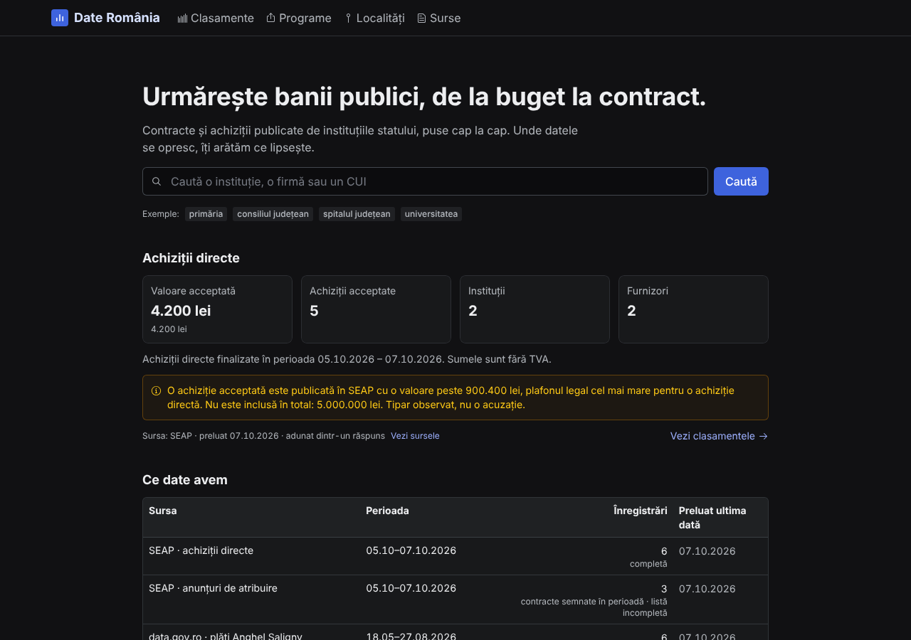

What you see: a headline ("Urmărește banii publici, de la buget la contract"), a large
search box with example searches (primăria, consiliul județean, spitalul județean,
universitatea), the headline figures for direct purchases (accepted value, number of
accepted purchases, institutions, suppliers), and "Ce date avem", a table of each source
held with its period, number of records and the day it was last read.

What you can do: search, or jump to the rankings or the sources.

## Search

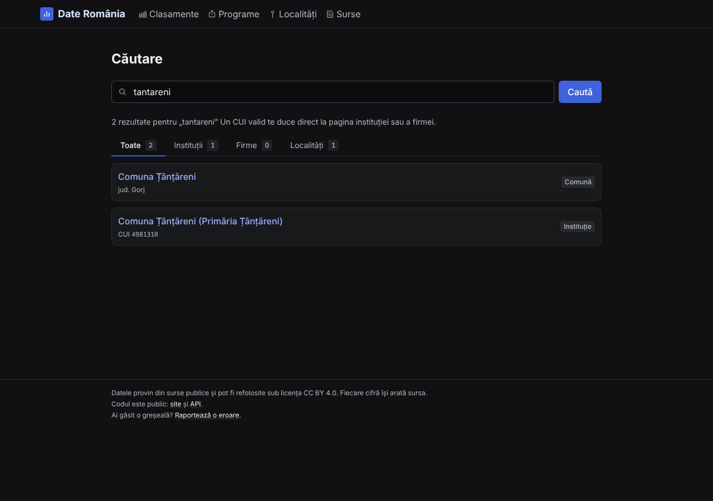

Type part of a name or a tax ID (CUI). Diacritics and small typos are forgiven
("Barzava" finds "Bârzava"). Results are split in tabs: "Toate", "Instituții",
"Firme".

- A **valid CUI** takes you straight to its page: the institution page if that CUI buys
  through SEAP, otherwise the company page.
- Search only knows institutions and companies that appear in the data held (direct
  purchases and award notices), and places: a commune, town or municipality by its name,
  or by the name of one of its villages ("Localități" tab).

## Institution page

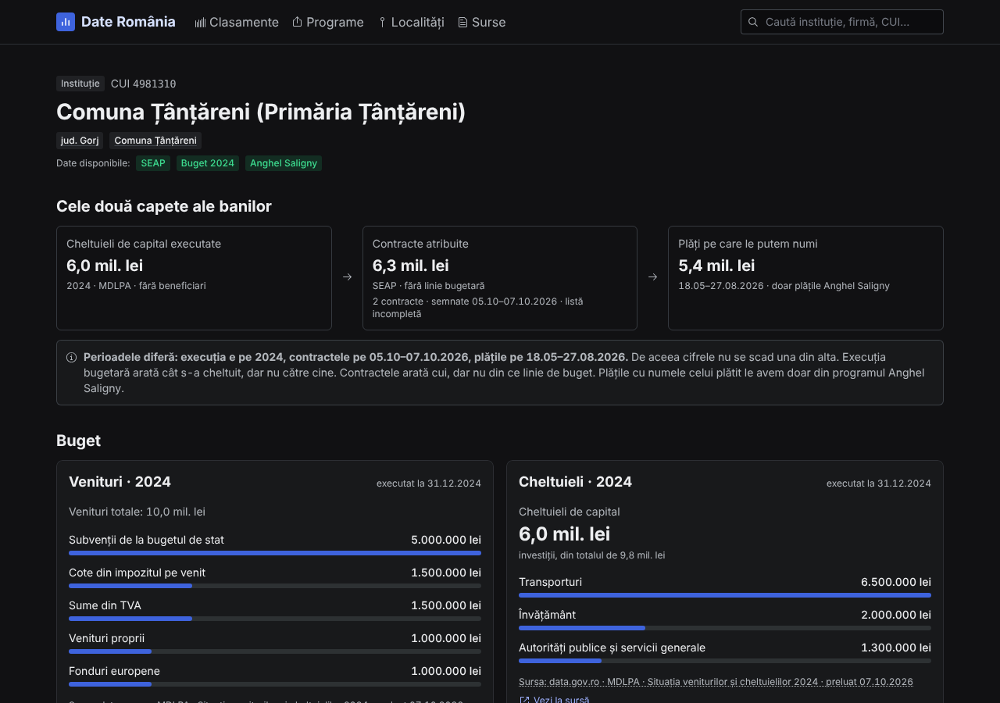

The page of a public body as a **buyer** (a town hall, a hospital, a ministry…).

1. **Header**: name and CUI, its county, the institution that funds it ("subordonată
   …", a link), and which sources are held for it ("SEAP", "Buget 2024", "Anghel
   Saligny").
2. **"Cele două capete ale banilor"** (the two ends of the money): three boxes side by
   side, capital spending executed, contracts awarded, and payments we can name. For a
   town hall or a county council, the first holds its capital spending of 2024 and the
   last the Anghel Saligny payments to it. The three cover different periods, so each
   box names its own, no bars are drawn and no difference is computed: the note under
   them opens "Perioadele diferă: …". A box not held is marked "Încă necolectat".
3. **"Buget"**: for a town hall or a county council, "Venituri · 2024" (revenue in seven
   lines that add up to the total: state subsidies, income tax shares, VAT shares, own
   revenue, EU funds, subsidies from other administrations, other) and "Cheltuieli ·
   2024" (capital spending, then spending by chapter: transport, education…), both
   executed to 31.12.2024, from the Ministry of Development. The Anghel Saligny payments
   to it are a card of their own, never added to the subsidies, with a link to its
   projects. Any other institution (a school, a hospital, a ministry) shows "Încă
   necolectat": the Finance Ministry publishes its budget, but it cannot be collected
   yet.
4. **Figures**: "Contracte atribuite" (contracts awarded, signed in the period held) and
   "Achiziții directe acceptate" (accepted direct purchases). The two are never added
   together.
5. **Tabs**:
   - "Contracte": the contracts it awarded, with winner, value and signing date, and a
     CSV export.
   - "Achiziții directe": every direct purchase, as a list you can filter, sort and
     chart (see below).
   - "Proiecte europene" and "Contracte PNRR", when it is the beneficiary of EU money
     (see below).

The page opens on the tab that has something to show. The link in your browser keeps
the tab, page and order you chose, so you can share exactly what you see.

### Filtering, sorting and charting the direct purchases

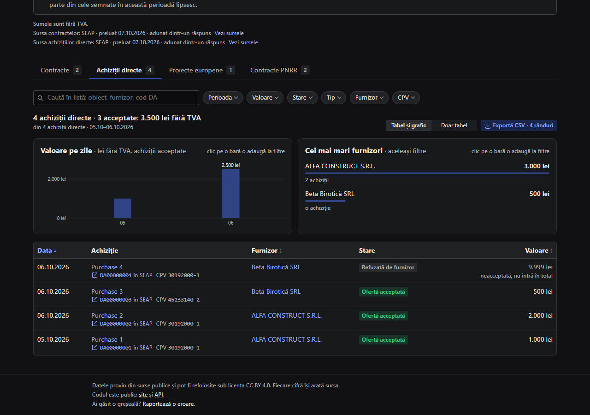

_Shown with made-up test data._

The "Achiziții directe" tab of an institution or a company is one list with these parts,
top to bottom:

- **"Caută în listă"**: words of the purchase's name, the other party or the DA code.
  The words found are marked in the rows.
- **Filters**, one button each: "Perioada" (with "Ultimele 30 de zile", "Luna trecută",
  each year held, or two days), "Valoare" (a range in lei, with the purchases in each
  band of value), "Stare" (accepted, refused, unanswered), "Tip" (goods, services,
  works), "Furnizor" or "Instituție" (the other party, by name or CUI) and "CPV" (a code,
  or a word of its name). Each option says how many purchases it would leave. A filter
  chosen shows its value and a × that removes it; "Șterge filtrele" removes them all.
- **The summary line**: how many purchases the filters keep, how many were accepted and
  what those add up to, out of how many the institution or company has, and over which
  days. Only accepted purchases under their legal limit are added, as everywhere on the
  site; those published above it are named apart.
- **Two charts**, of accepted purchases only: their value per month (per day for a short
  period; a month not over yet is outlined), and the largest suppliers or institutions.
  Clicking a month or a name filters the list by it. "Doar tabel" hides the charts.
- **The table**: click "Data", "Valoare" or the other party's column to sort the whole
  list, not just the page shown; a second click reverses it, a third goes back to newest
  first. With "Stare: acceptate" alone, a last row gives the total.
- **"Exportă CSV"** downloads the list as filtered and sorted, every row with its source.
- **The pager**: page numbers, and 25, 50 or 100 rows a page.

When the filters leave nothing, the page names the filter that would give purchases
back, and how many, with a button that removes it. Every choice is kept in the link.

### The other lists of an institution or a company

The tabs "Contracte", "Proiecte europene" and "Contracte PNRR" work the same way: a
search, filters, a summary line, charts, sortable columns and the pager. What differs:

- **Contracte**: filters by period (the day signed), value, the other party, CPV, "Fel"
  (an ordinary or a subsequent contract) and "Fonduri UE". A company's list is either the
  contracts it won alone or those it won in an association, never the two added: it
  opens on what it won alone, and "Câștigat" switches. On an institution's page the
  chart ranks the winners by what they won alone; the contracts won by associations are
  a bar of their own, never given to one member.
- **Proiecte europene**: filters by programme, status and value. Each programme's figures
  are of its own list's day, so they are never added: the summary gives a value only
  when one programme is chosen. The charts show the value per programme, side by side,
  and the projects by status.
- **Contracte PNRR**: filters by measure, status, value and physical progress. A
  contract's status and progress are those all its measures agree on; one whose measures
  differ is counted apart. The charts show the contracts by status and by progress.

### EU money of an institution or a company

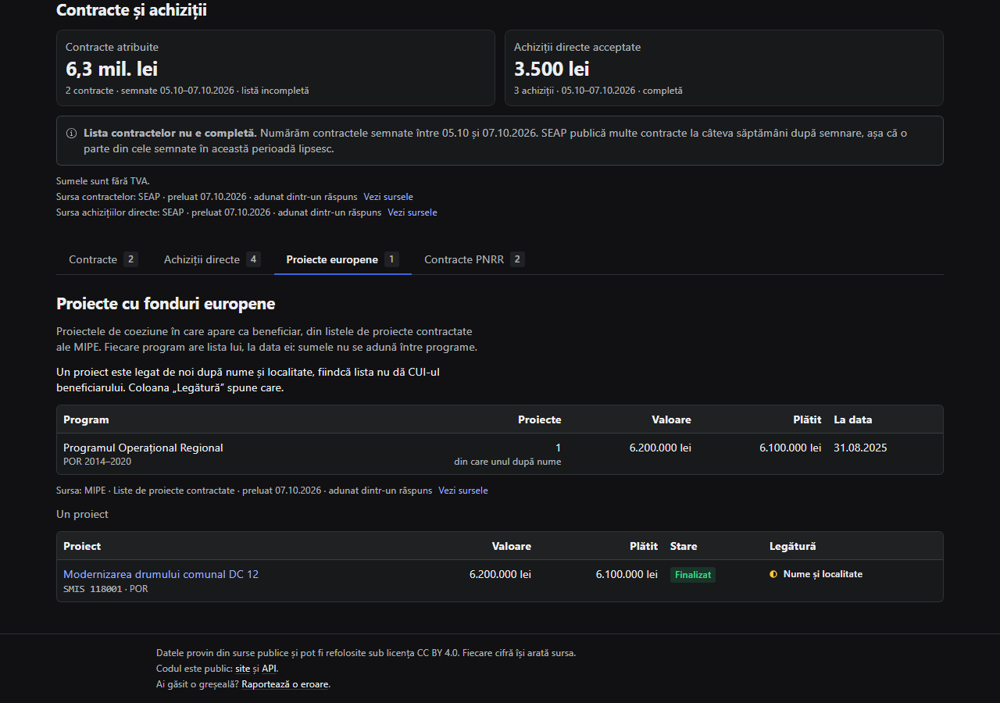

An institution or a company that receives EU money has one tab for each kind it has.
The two kinds are never added together.

- **"Proiecte europene"**: its cohesion projects. First comes a table by programme with
  the number of projects, their value, what was paid and the day of the programme's
  list. It has no total row, because each programme's list describes a different day.
  Then come the projects one by one, largest first. The "Legătură" column says how the
  project was tied to this institution or company: "CUI în listă" when the list gives
  its tax ID, or "Nume și localitate" when the list gives only a name and Date România
  matched it. When some projects were matched by name, a line above the table says how
  many, and the programme table says it for each programme ("din care unul după nume").
- **"Contracte PNRR"**: the value of its PNRR financing contracts, and the PNRR payments
  it received with the first and last day. A payment names the beneficiary and a
  measure, never the contract, so the payments are never split among its contracts.
  Then comes the list of contracts. A beneficiary that was paid on a measure where it
  has no contract still has the tab, with the payments and a line saying so.

## Company page

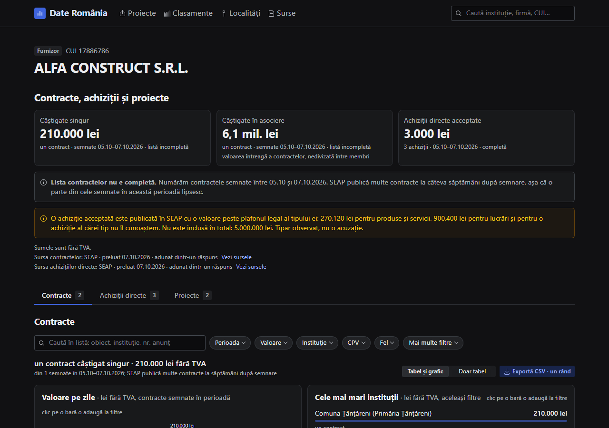

The same layout, flipped: a company as a **seller**.

- Figures: "Câștigate singur" (contracts won alone), "Câștigate în asociere" (won as part
  of an association, at the full value of the contract) and "Achiziții directe
  acceptate". They sit side by side and are never added, because a contract won in an
  association would otherwise be counted once per member.
- Tabs: its contracts, and the institutions it sold to directly, with every sale. A
  company that receives EU money has the same two EU tabs as an institution.

## Award notice page

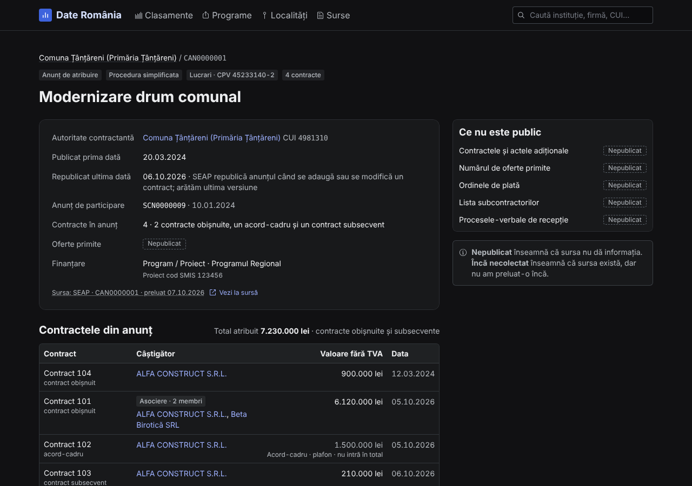

One SEAP award notice, which can hold **several contracts**.

- Title, procedure type, CPV code, buyer ("Autoritate contractantă"), financing, the day
  it was first published and last republished, and the "Anunț de participare" (the
  notice that opened the procedure).
- A version SEAP has withdrawn says so ("SEAP a retras această versiune a anunțului")
  and links to the new version, where its contracts are counted.
- "Contractele din anunț": one row per contract, with its winner(s), value without VAT
  and date. Above the table, the notice's total counts ordinary and subsequent contracts.
- A framework agreement shows muted as "Acord-cadru · plafon · nu intră în total": it is
  a ceiling, not money spent.
- An association shows the badge "Asociere · N membri" with its members in SEAP's
  order.
- "Ce nu este public": a fixed list of what SEAP does not publish (signed contracts and
  addenda, the number of offers, payment orders, subcontractors, reception documents).
- A link to the notice on SEAP ("Vezi la sursă").

## Direct purchase page

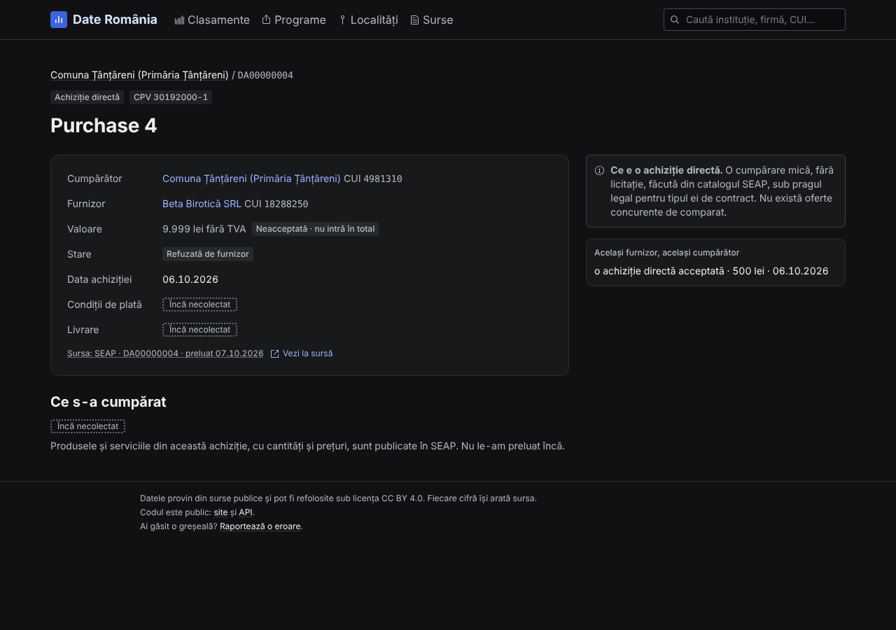

A small purchase made without an auction, from SEAP's catalogue.

- Buyer, supplier, value without VAT, state and date.
- "Plafon legal": the ceiling the purchase is held to, by its type (270,120 lei for
  goods and services, 900,400 lei for works, the higher one when the type is not known),
  or "Fără plafon" for the services of Annex 2 of Law 98/2016, which have none.
- A purchase that was not accepted shows its value muted, "Neacceptată · nu intră în
  total"; one published above the ceiling of its type shows "Peste plafon · nu intră în
  total".
- "Ce s-a cumpărat": the items bought, each with its quantity and value without VAT, and
  their total, with the payment and delivery conditions above, in the buyer's own words.
  They come from the purchase's own page in SEAP, one request each, so they are
  collected for accepted purchases of 100,000 lei or more, newest first. For the others
  they are marked "Încă necolectat". A line the supplier turned down is muted and marked
  "Refuzat de furnizor", and a note under the total says it leaves such lines out.
- Two source lines, one per SEAP answer read: "Sursa achiziției" under the facts (the
  list row), and "Sursa produselor" under the table (the purchase's own page).
- "Același furnizor, același cumpărător": how many accepted purchases the same pair made
  in the period, and for how much.

## Localities

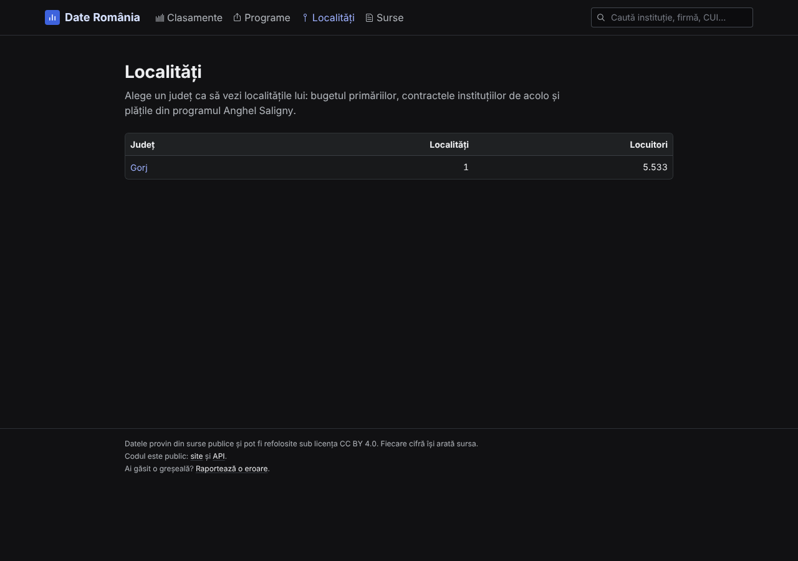

The 42 counties (Bucharest is one), each with its number of UATs (communes, towns,
municipalities, Bucharest sectors) and people. A county opens its page.

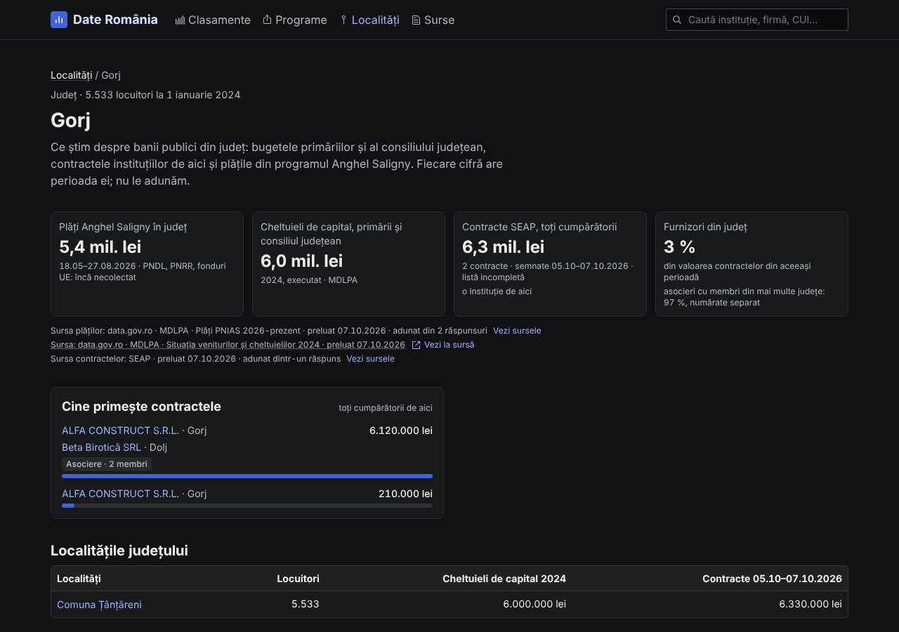

**A county.** The same figures as a locality,
added up over its UATs and its county council, the county council's EU money in short,
then a table of every UAT with its
population, capital spending in 2024 (the year of the UATs' budgets, the council's left
out) and contracts signed in the period held.

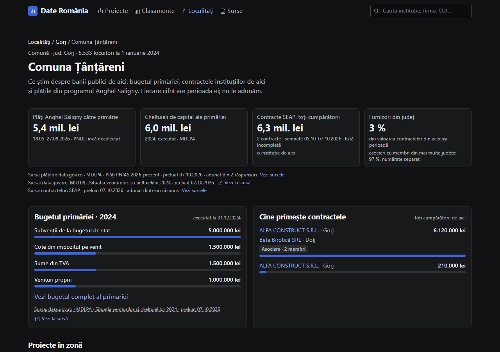

**A town or commune.** One UAT:

1. Its kind, county and population at 1 January 2024, and a lead saying every figure has
   its own period and none is added to another.
2. Four figures, each with its period: the Anghel Saligny payments to its town hall
   (PNDL, another national programme, is not collected yet), the town hall's capital spending in 2024,
   the contracts of every institution located here, and the share of them won by
   suppliers of the county (an association counts only when all its members are; one
   with members in several counties is counted apart).
3. The town hall's budget (its largest revenue lines, and a link to the whole budget on
   its page), and who gets the contracts, each supplier with its county.
4. "Proiecte în zonă": the town hall's Anghel Saligny projects, with the progress as the
   town hall types it and whether a SEAP contract was found. Under them, "Fonduri
   europene": the town hall's EU money in two lines ("2 contracte PNRR · plăți primite
   2,3 mil. lei, 19.12.2025–02.10.2026"), each with a link to the full list on the town
   hall's page. Projects matched to the town hall by name are counted as such. Only the
   town hall's own projects are shown here, not those of every company or institution
   located in the place.
5. "Plăți ale primăriei": we do not hold whom the town hall paid; its payments can be
   asked for under Law 544/2001.
6. "Instituții din localitate": every institution located here, with its contracts and,
   for the town hall, its capital spending.

Bucharest's page adds up its six sectors and links to each; its payments figure names
the town hall and its sectors. A village, or a component locality of a town, has no page
of its own: searching it opens its UAT, with the line "Localitatea X face parte din Y."

## Rankings

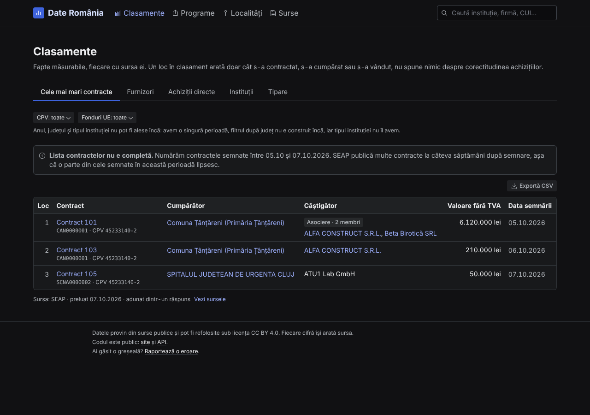

Five tabs, each a measurable fact with its source:

| Tab                       | What it ranks                                                                                               |
| ------------------------- | ----------------------------------------------------------------------------------------------------------- |
| "Cele mai mari contracte" | The largest contracts signed in the period                                                                  |
| "Furnizori"               | Companies by value of contracts won; switch between won alone ("Singur") and in association ("În asociere") |
| "Achiziții directe"       | Suppliers and institutions by accepted direct purchases, kept apart from contracts                          |
| "Instituții"              | Institutions by value of contracts awarded                                                                  |
| "Tipare"                  | Patterns worth asking documents about (see below)                                                           |

Filters: **CPV** (the category of what was bought, by its first two digits, for example
45 for construction works) on every tab, and **Fonduri UE** (EU funds: yes or no) on the
contract tabs. A note says which filters cannot be offered yet (year, county,
institution type) and why.

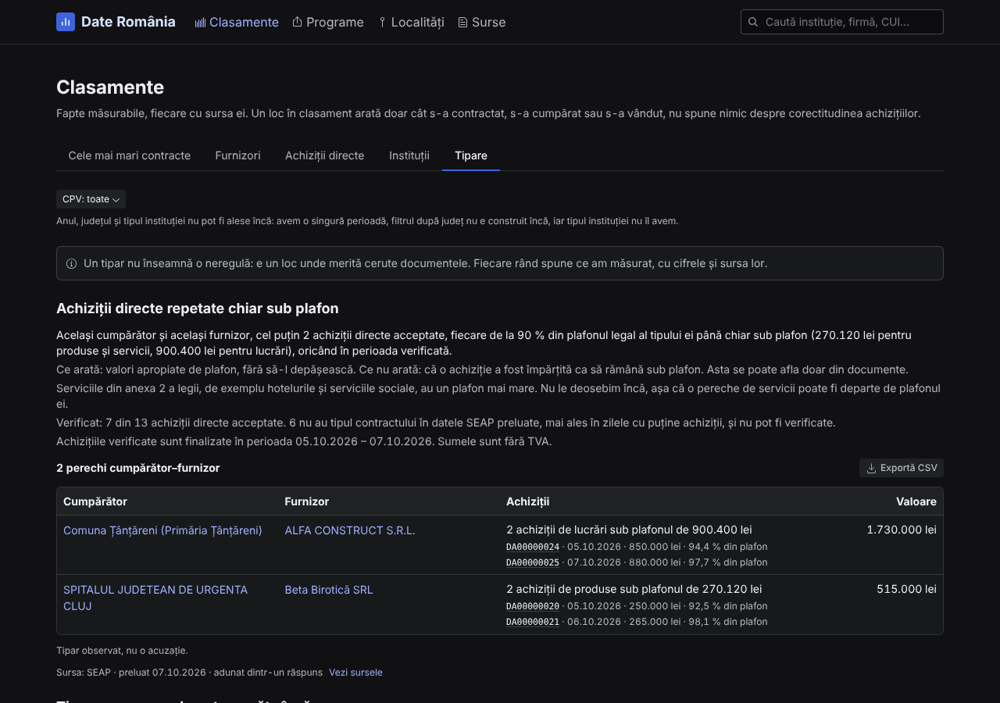

**"Tipare" (patterns).** One pattern is shown today: **repeated direct purchases just
under the legal ceiling**, the same buyer and the same supplier with at least two
accepted direct purchases, each between 90% of the ceiling for its type and the
ceiling. Each row says what was measured and links to both parties; the list downloads
as a spreadsheet. The page explains what the pattern shows and what it does not: a
value close to the ceiling does not prove a purchase was split. Services of Annex 2
(health, social, education, hotels and others) have no ceiling and are not checked; the
page says how many there are. Patterns that the data cannot give yet are listed with the
reason.

## Programmes

"Programe" lists the three programmes followed, each with its own page: the PNRR, the
EU cohesion funds and Anghel Saligny.

### Anghel Saligny

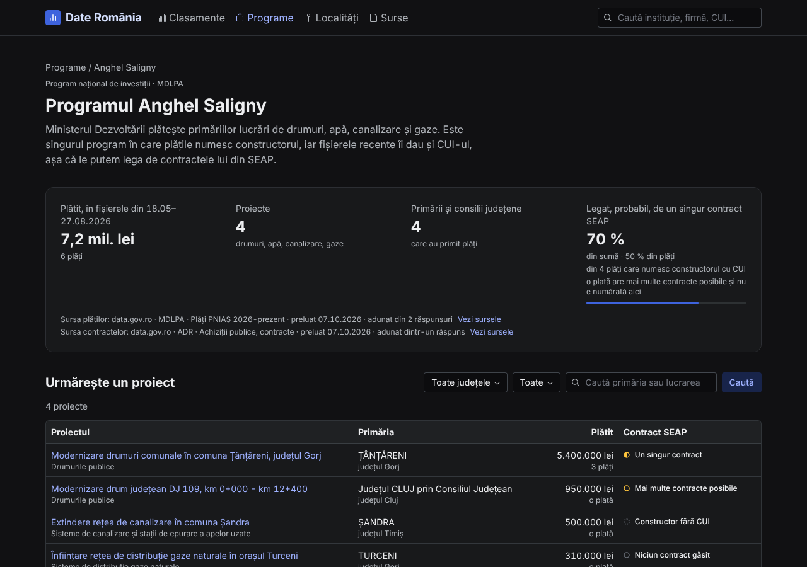

The Anghel Saligny national investment programme: the ministry (MDLPA) pays town halls
for roads, water, sewage and gas works.

- Headline figures: amount paid in the payment files held, number of projects, town
  halls and county councils paid, and the share of the money that could be tied,
  probably, to one SEAP contract.
- "Cum s-au legat plățile": how a payment is tied to a contract, in plain words.
- "Urmărește un proiect": a finder with a county select, a match-state filter and a
  search on the town hall or the works.
- The list of payment files held, with how many name the builder's CUI.

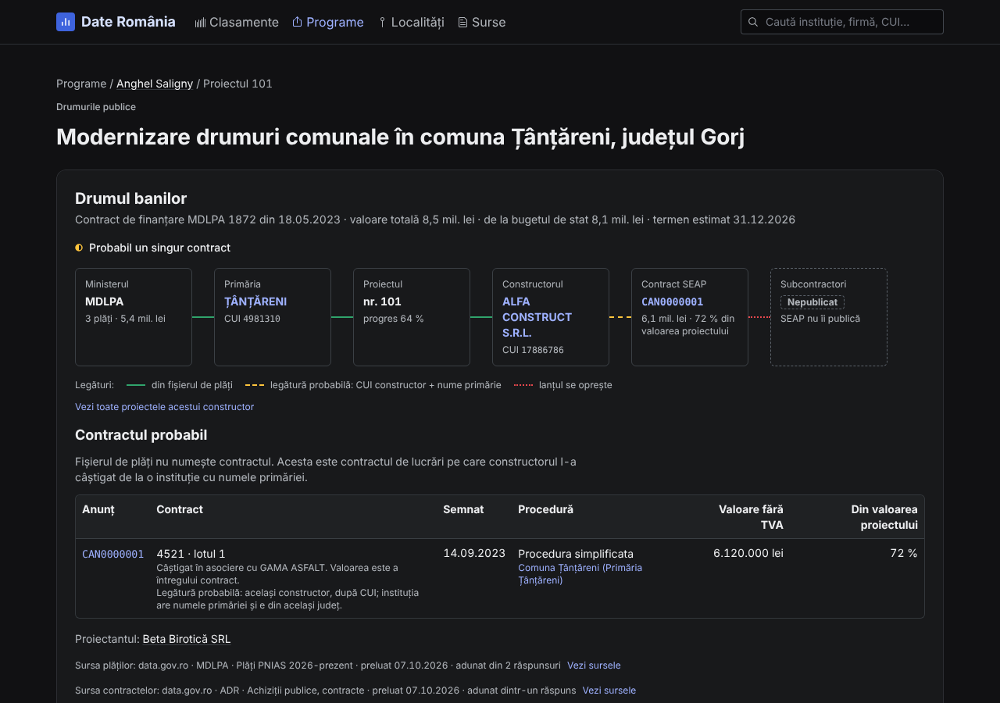

**Project page**: the ministry's financing
contract, total value, the state budget share, progress, designer and builder, and
"Drumul banilor", the chain **ministry → town hall → project → builder → SEAP
contract**. Each hop says where it comes from and how sure it is. The project's payments
are listed below. A project has one of four states:

| State                              | Meaning                                                              |
| ---------------------------------- | -------------------------------------------------------------------- |
| "Probabil un singur contract"      | One contract fits; the chain is complete                             |
| "Mai multe contracte posibile"     | Several contracts fit; all are shown, none is picked                 |
| "Niciun contract găsit"            | The chain stops at the builder; likely reasons are listed            |
| "Constructor numit doar cu numele" | The file gives only the builder's name, no CUI, so no search is made |

From a project you can open the builder's page, the town hall's page, the SEAP notice,
or every project of the same builder.

### PNRR

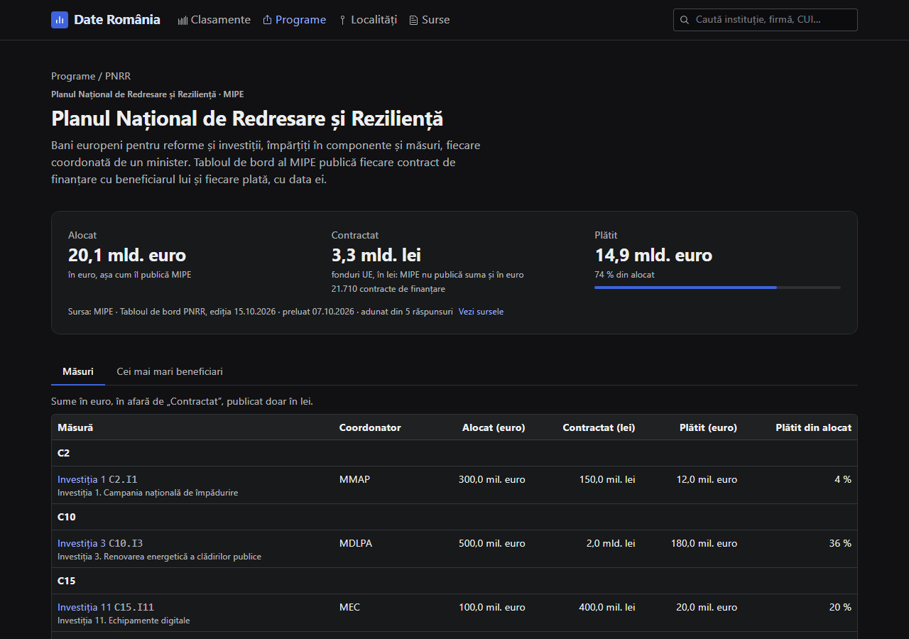

`/programe/pnrr`, from MIPE's PNRR dashboard: one edition, named in the source line.

- Allocated and paid in euro, contracted in lei: each as MIPE publishes it, never
  converted.
- "Măsuri": the 143 measures by component, with the share paid of the allocation.
  "Cei mai mari beneficiari": the largest final recipients, which an EU rule asks every
  country to publish.
- A measure (`/programe/pnrr/c10.i3`): its money, what went to beneficiaries with no
  contract on it, and its contracts, by county, status or words. Contracts of natural
  persons (afforestation grants) are never listed or named; the page says how many there
  are.
- A contract (`/programe/pnrr/contracte/{id}`): its value, the progress the ministry
  reports (never worked out from payments), and the payments to its beneficiary on each
  measure. The payments name the beneficiary and the measure, not the contract: they are
  shown as the contract's own only when it is the beneficiary's one contract there;
  otherwise "Plătit pe acest contract · Nu putem spune", with the beneficiary's payments
  and contracts on the measure side by side. A contract on several measures that report
  different progress shows each measure's.
- Under the contract, the SEAP contracts and direct purchases that cite it (see below).

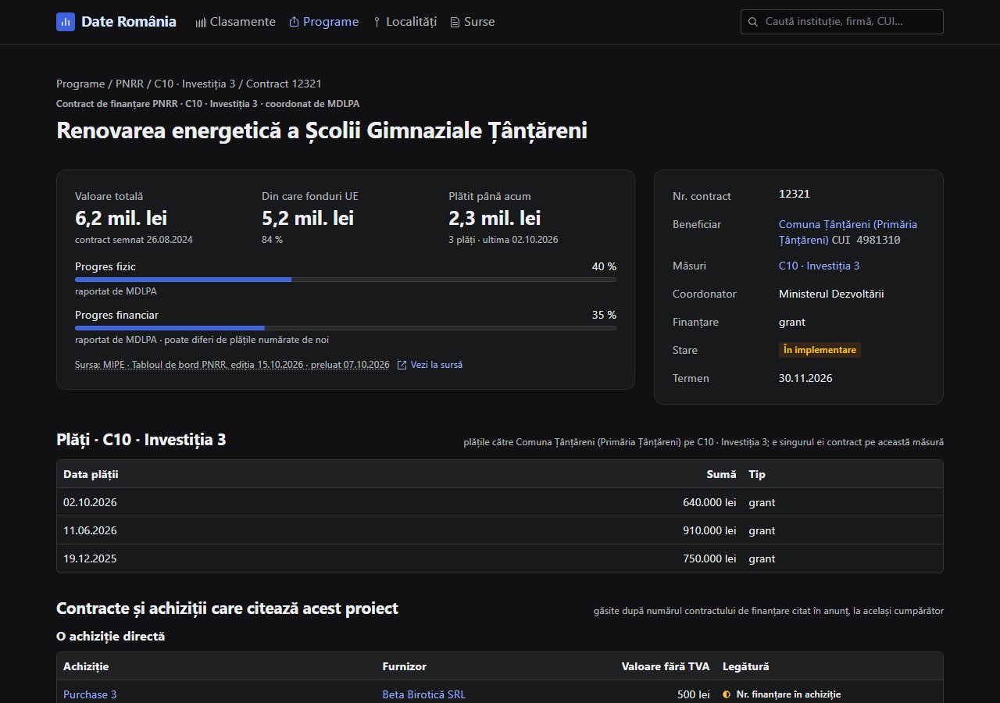

### EU cohesion funds

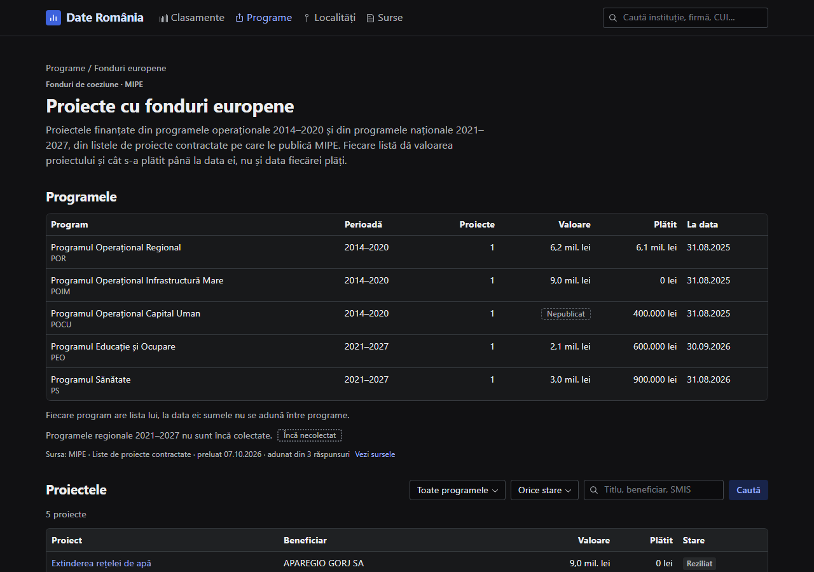

`/programe/fonduri-europene`, from the lists of contracted projects that MIPE (the
ministry for EU funds) publishes for each programme: the 2014–2020 operational
programmes and the national programmes of 2021–2027. The regional programmes of
2021–2027 are not collected yet, and the page says so.

- "Programele": one row per programme with its projects, value, paid so far and the day
  its list describes. Each programme has its own list and its own day, so the programmes
  are never added together.
- "Proiectele": a finder by programme, by status ("În implementare", "Finalizat",
  "Reziliat"), or by words in the title, the beneficiary's name or the SMIS code.

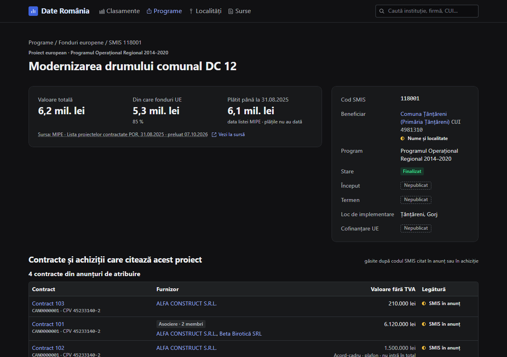

**Project page** (`/programe/fonduri-europene/proiecte/{smis}`): the title, value, the
EU share, "Plătit până la {day}" (what was paid up to the day of the list; the lists give
no payment days), status, dates, place, partners and the beneficiary with how it was
tied ("CUI în listă" or "Nume și localitate"). Projects of the Health programme also
list their payments one by one, with their days, since that programme publishes them.

**Contracts and purchases that cite a project.** On both kinds of project page (a
cohesion project and a PNRR contract), "Contracte și achiziții care citează acest
proiect" lists the SEAP contracts and the direct purchases whose text cites the project.
For a cohesion project the text cites its SMIS code. For a PNRR contract it cites the
financing contract number, and only purchases by the contract's own beneficiary count.
SEAP has no field for the project: the buyer writes it in free text, when it does. So
every such link is "probabil" (badges "SMIS în anunț", "Nr. finanțare în anunț" and so
on), and the list may be incomplete. Contracts and direct purchases are in two tables,
never added. A row bought by a partner rather than the beneficiary says "cumpărat de …".

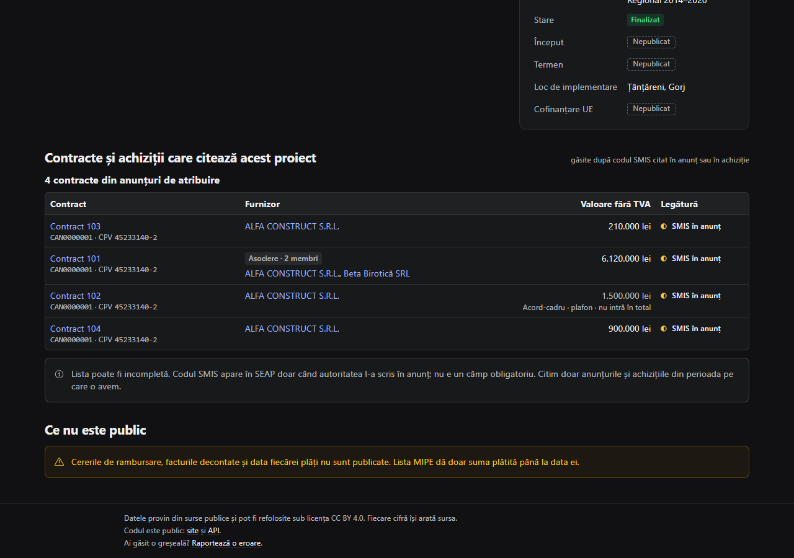

## Sources

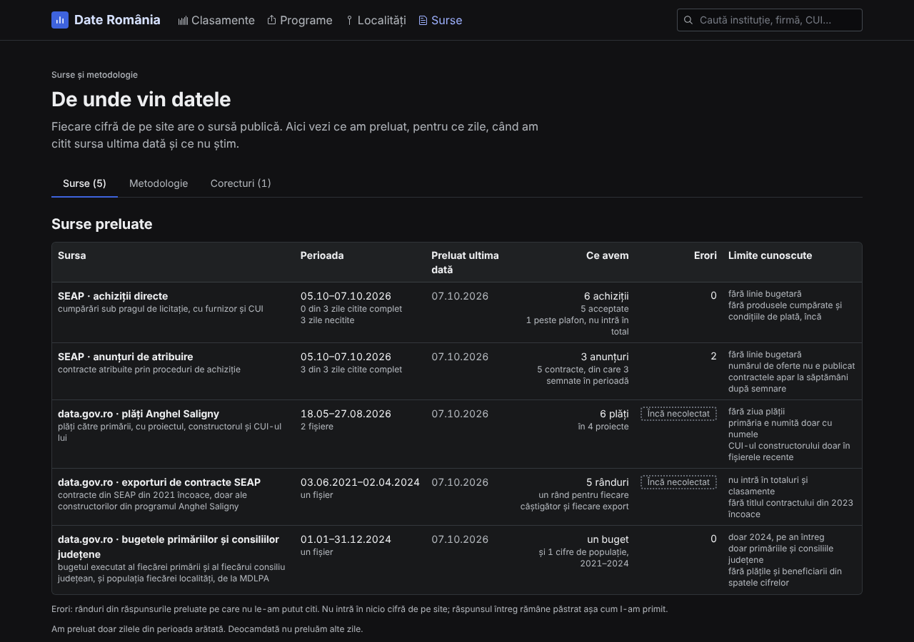

Three tabs:

- **"Surse"**: one row per source held, with the period, the day it was last read, what
  is held in the source's own units, "Erori" (rows that could not be read: logged, kept,
  never counted) and its known limits. A second table lists public sources not collected
  yet. A link exports every contract of the period as CSV.
- **"Metodologie"**: "Cum numărăm", the counting rules in plain words. See
  [Reading the figures](Reading-the-Figures).
- **"Corecturi"**: corrections made after readers' reports.

**Reporting an error.** Every page's footer has "Raportează o eroare". The form takes
the page address, what is wrong and, optionally, a link to evidence. A person reads each
report before anything changes; only the reviewer's description of an accepted
correction is published, never the reader's text. A reader can send at most 5 reports
an hour.

## Downloads

Every list of contracts has a download button that gives a CSV file (it opens in Excel
or any spreadsheet program): all contracts of the period from "Surse", or one
institution's or one company's contracts from its page. The purchases behind the "just
under the ceiling" pattern download from the "Tipare" tab.

Each row keeps its source and the day it was read. The data is free to reuse under CC BY
4.0, naming Date România and the original source.
